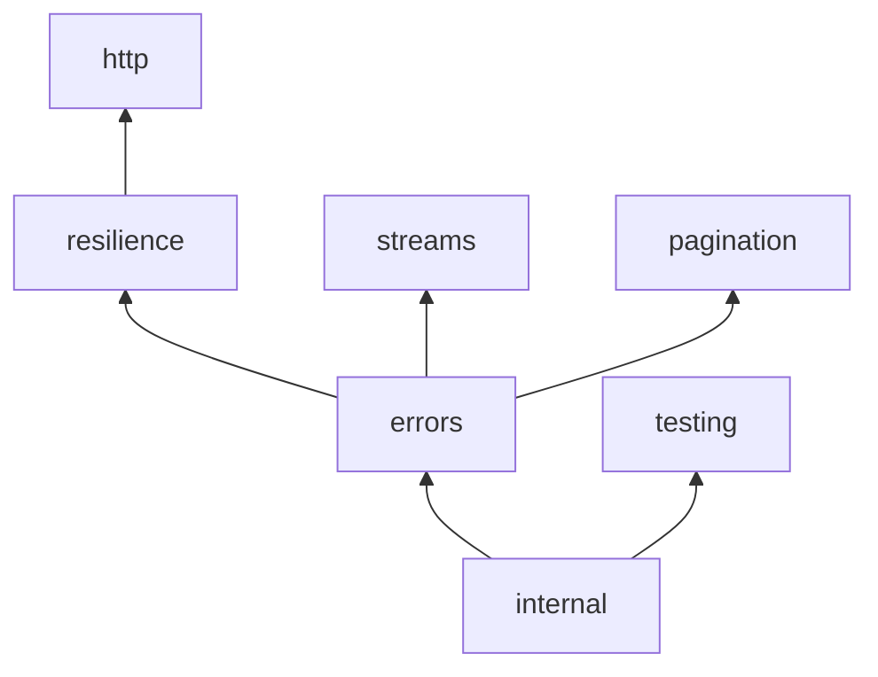

# Architecture

reqkit is a set of small, independent functions with **no runtime dependencies**, written as CommonJS and using only web-standard APIs (`fetch`, `Response`, `Headers`, `AbortSignal`, `ReadableStream`), so the same code runs on Node 18+, Deno, Bun, Workers and browsers.

## Layout

```
src/
  index.js / index.mjs      public entry points (the ESM one re-exports the CJS one)
  internal/                 private helpers — never exported
  errors/                   HTTPError, normalizeError
  resilience/               retry, timeout, dedupe, limiter, rateLimiter, circuitBreaker
  http/                     createFetch, buildQuery, parseJsonSafe, cache/
  streams/                  readers (lines/NDJSON/SSE), streamSSE, progress, download
  pagination/               paginate, paginateLinks, parseLinkHeader
  testing/                  createMockFetch
types/                      hand-written .d.ts — one file per layer + index.d.ts re-exporting them
test/                       mirrors src/ — plus helpers/, package/, security/, playground/
playground/                 the Pages demo (index.html, demo.mjs, generated reqkit.mjs bundle)
smoke/                      runtime-agnostic checks (Node, Deno, Bun, headless Chromium)
scripts/build-esm.js        builds the dependency-free ESM bundle
docs/                       this file, recipes, release process
```

## Layers

Lower layers know nothing about higher ones. A layer may only `require` itself and the layers listed below — `test/package/architecture.test.js` enforces this, plus: no cycles, no dependencies, no dead modules, and `types/` + `test/` mirroring the layers.



Arrows point from a layer to the layers that use it. (Every layer except `testing` may also use `internal` directly, and `http` may use `errors` directly — the table below is the exact rule.)

| Layer | May depend on | What lives here |
|---|---|---|
| `internal` | — | abortable sleep, Retry-After / rate-limit header parsing, `getOrigin`, `discardBody` |
| `errors` | internal | `HTTPError`, `normalizeError` (one error shape for fetch, axios, undici, node) |
| `resilience` | internal, errors | `withRetry`, `retryAfterAware`, `withTimeout`, `withDedupe`, `createLimiter`, `createRateLimiter`, `createCircuitBreaker` |
| `http` | internal, errors, resilience | `createFetch` (assembles the above), `buildQuery`, `parseJsonSafe`, the response cache |
| `streams` | internal, errors | `readLines` / `readNDJSON` / `readSSE`, `streamSSE`, `withProgress`, `downloadResumable` |
| `pagination` | internal, errors | `paginate`, `paginatePages`, `paginateLinks`, `parseLinkHeader` |
| `testing` | internal | `createMockFetch` |

`streams`, `pagination` and `http` are siblings: none of them requires another. `src/index.js` is the only file allowed to import from every layer.

## Conventions

- **Everything composes by taking and returning plain functions/`Response`s.** No classes you must extend, no global state (except the WeakMap that makes concurrent token refreshes share one refresh).
- **Errors live next to the feature that throws them** (`TimeoutError` in `resilience/timeout.js`, `BodyTooLargeError` in `streams/progress.js`, …) and are re-exported from `src/index.js`. Their `code`s never start with `E` + capitals (so `normalizeError` can't mistake them for network errors).
- **Abort is first-class.** Anything that waits takes a `signal` and rejects with `signal.reason`.
- **Untrusted input.** Headers, streams and `Link`s come from servers: parsers are linear-time and bounded, and credentials never leave the trusted origins.
- **Types are hand-written** (no build step to go wrong) and checked by `typecheck/` against both the ESM and CJS entry points.

## How a `createFetch` request flows

```
request(url, init)
 ├─ join baseUrl + query; decide whether this origin may receive default credentials
 ├─ merge default headers (sensitive ones dropped for foreign origins) + json body + onRequest hook
 ├─ auth: attach the token                                   (http/createFetch)
 ├─ cache lookup → fresh hit / stale-while-revalidate        (http/cache)
 └─ network()
     └─ withRetry ── per attempt ──────────────────────────  (resilience/retry)
         └─ circuit breaker                                  (resilience/circuitBreaker)
             └─ rate limiter: acquire                        (resilience/rateLimiter)
                 └─ withTimeout (per attempt) → dedupe → fetch
             └─ rate limiter: learn from X-RateLimit-* / Retry-After
 ├─ 401 → refresh the token once (single-flight) → replay
 ├─ 304 → reuse the cached body; 200 → store in the cache
 └─ onResponse hook → throw HTTPError if !ok
```

## The ESM bundle

`scripts/build-esm.js` wraps every file in `src/` in a function and adds a tiny relative-path `require`, producing one dependency-free file (`dist/reqkit.mjs`, shipped to npm as `@boy-offi9-inc/reqkit/browser`; a copy in `playground/` powers the demo). It refuses to bundle a non-relative `require`. `playground/reqkit.mjs` is committed on purpose — Pages serves it — and a test fails if it's stale (`npm run build` fixes that).

## Adding a feature

1. Put it in the layer where it belongs (if it needs something from a higher layer, it belongs higher — or the dependency is wrong).
2. Export it from **both** `src/index.js` and `src/index.mjs` (`test/package/exports.test.js` catches a miss).
3. Add its types to the layer's file in `types/` and exercise them in `typecheck/`.
4. Add tests under the mirrored `test/<layer>/` — prefer real local servers (`test/helpers/server.js`) or `createMockFetch` over stubs.
5. If it's user-facing: a README section, and a portable check in `smoke/checks.mjs` (and a playground demo if it's visual).
6. `npm run check` (build + test + typecheck + smoke) must pass.

## Testing strategy

| Where | What |
|---|---|
| `test/<layer>/` | unit + integration tests; HTTP behavior is tested against real servers on `127.0.0.1` |
| `test/security/` | credential scoping and other attacks, written as regression tests |
| `test/package/` | exports parity (CJS ↔ ESM ↔ bundle), bundle freshness, architecture rules |
| `test/playground/` | the demos' outcomes and the page's DOM wiring (with a DOM stub) |
| `smoke/` | the same checks on Node, Deno, Bun and headless Chromium in CI |
| `typecheck/` | compile-only tests for the `.d.ts` files, ESM and CJS consumers |
